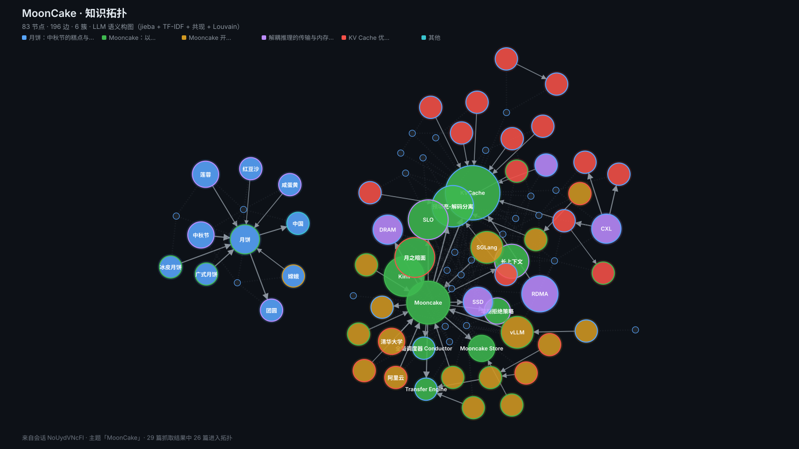

# DeepEye · 智能多源搜研与知识星云拓扑系统

<p align="center">
  
  
  
  
  
</p>

> **输入一个主题，跨站点穿透搜集海量长尾资料 → 智能预筛与深度抽取清洗 → 织成 2D/3D 可交互全息知识拓扑星云 → 实体分类与谓词关系去乱 → 导出专业 Markdown 深度调研报告并异步归档下载。**

---

## 📖 项目简介 (Overview)

在大模型时代，获取信息不再困难，困难的是**如何从海量零散长尾网页中提炼出结构化的高维决策知识**。传统的搜索引擎给出的只是一列线性卡片列表，用户必须逐条点击、肉眼分辨真伪与切题程度，面对“大模型-高校机构-技术实现-开源产品”这类复杂的纵深主题时极易迷失。

**DeepEye** 致力于将一次主题调研转化为一张**结构分明、时序演进清晰、可交互穿透的活拓扑**：
1. **多源穿透检索**：聚合 SearXNG、Serper、B站公开接口、YouTube、知乎、小红书扫码登录态、微信公众号等，跨平台穿透长尾反爬屏障。
2. **体裁与价值预筛**：前置拦截招聘、招投标、二手交易及用户主页等噪音，配合词法/LLM 双轨相关性评测，确保抓取成本用在刀刃上。
3. **全息实体构图与关系去乱**：
   - 区分**高校/机构**（组织）、**技术实现**（技术）、**衍生模型/工具**（产品）、**基础理论**（概念）等实体类别，双层映射视觉标签与类型环；
   - 彻底梳理边关系：突出核心**语义谓词边**（实线加粗 + 直观谓词标签），弱化统计**共现边**（虚线淡化），消除稠密发线团，支持一键“仅看语义关系”；
   - 引入 **10 年自适应时序分层** 与每年统计维度指标标尺，支持时序演进展平与动力学力导向双模切换。
4. **2D/3D 双维空间渲染**：2D (Cytoscape + fcose) 精细拖拽微调与圈选锁定；3D (Three.js WebGL) 沉浸式太空星云穿梭、动态光子能量流与发光微环。
5. **本地数据主权与交付**：零第三方数据库依赖，会话与资产完全落盘本地；一键导出带分簇章节的深度 Markdown 报告、多风格矢量 SVG 及离线媒体包。

---

## 🖼️ 最新效果展示 (Visual Showcase)

下图为系统对前沿技术主题 **「Mooncake (KVCache 分离式架构与大模型推理调度优化)」** 进行全流程深度调研后，由生产级接口 `GET /api/export/image` 实时渲染生成的最新知识拓扑矢量大图：



> **✨ 视觉与交互特性：**
> - **无方块圆徽美学**：彻底消除生硬的方形文档盒，所有资料节点与概念统一升级为精致圆形微徽章与晶体球。
> - **双层身份感知**：节点背景色映射**主题簇**归属，外层边框与 3D 光环映射**实体类型**（珊瑚橙: 组织高校，科技蓝: 技术实现，翡翠绿: 模型产品，紫罗兰: 基础概念）。
> - **显式谓词边**：大模型架构与具体高校研发、技术底座之间的关联直接以带方向的实线谓词标于线上（如 `[优化]`、`[支持]`、`[基于]`），共现边自动虚线弱化。

---

## ⚡ 全景工作流设计 (Architecture & Workflow)

```
用户输入主题（如「Mooncake 推理优化」）+ 意图提示
  │
  ├─ 1. 查询规划与意图扩展 (Search Plan)
  │     └─ 意图提取、型号消歧、专名别名扩展、各站点定制查询变体生成
  │
  ├─ 2. 深度多源检索 (Multi-source Search)
  │     └─ 聚合 SearXNG / Serper / B站开放接口 / YouTube / 知乎 / 小红书 / 微信公众号
  │
  ├─ 3. 质量闸门与切题预筛 (Quality Gate & Relevance)
  │     ├─ 体裁过滤：彻底阻断招聘、招标、二手交易、UP主个人主页
  │     └─ 价值预判：区分部署实践/原理分析/短讯，跳过无实质价值的登录墙与标题党
  │
  ├─ 4. 深度正文抽取流水线 (Extraction Pipeline)
  │     ├─ 站点适配器通道：B站 API (字幕/标签/简介)、YouTube yt-dlp 字幕
  │     ├─ 真实正文穿透：知乎专属容器提取 + 本地 0600 安全扫码登录凭证
  │     ├─ 防爬穿透：微信公众号补齐 Referer，JS 空壳页按需 Playwright 无头渲染
  │     └─ HTML → 结构化纯净 Markdown 与图文清洗
  │
  ├─ 5. 全息知识星云构图 (Graph Modeling)
  │     ├─ 启发式（jieba-wasm + POS 词性推导 + TF-IDF + Louvain 社区发现）
  │     ├─ LLM 语义构图（实体属性抽取 + 谓词关联推导 + 综述生成）
  │     ├─ 10年时序推导：支撑文档时间提取 + 拓扑邻居时序扩散 + 年度统计维度标尺
  │     └─ 交互去乱控制：实体类型过滤 + 谓词边筛选（剔除毛球）
  │
  └─ 6. 成果交付与归档 (Delivery & Archives)
        ├─ 2D/3D 可视化交互：4 种主题风格（默认暗调/极深暗夜/宣纸报告/高对比）
        ├─ 深度调研报告：按主题簇分章的 Markdown 文档与矢量 SVG
        └─ 离线资源包：带断点续传与原子落盘的多媒体/文章本地下载
```

---

## 🚀 核心特性矩阵 (Key Features)

| 维度 | 功能特性 | 技术实现与优势 |
| :--- | :--- | :--- |
| **拓扑可视化** | **2D/3D 双模空间交互** | 2D 基于 Cytoscape + fcose 力导向，支持框选锁定与视口平滑复原；3D 基于 Three.js，具备太空粒子深空背景、动态能量光子流与 Billboard 文字。 |
| | **实体分类与关系去乱** | 自动标注组织/高校、技术实现、模型产品、核心概念；语义关系边实线加粗 + 显式谓词标签，共现边虚线淡化；支持独立悬浮过滤条一键筛选。 |
| | **10年时序分层拓扑** | 自动提取与拓扑推导节点发布年份，自适应收敛在最近 10 年，并在画布左上方直观渲染每年统计维度标尺。 |
| **搜索与预筛** | **型号消歧与意图补搜** | 彻底解决含连字符的型号名（如 `DeepSeek-V4.1-Flash`）被拆成碎片 token 导致查询漂移的问题；支持多轮自动补搜。 |
| | **精准体裁过滤闸门** | 关键词与结构化规则双重拦截招聘求职、招投标、二手售卖、个人动态流等噪音，避免垃圾数据污染图谱。 |
| **抓取穿透** | **官方扫码安全登录** | 知乎、小红书官方登录页扫码登录，cookie 本地 `0600` 安全落盘，不逆向签名头、不触碰用户账密，零泄露风险。 |
| | **平台通道深度定制** | B站视频/专栏原生接口直读；公众号补齐防盗链请求头；JS 渲染型站点按需唤起 Playwright 无头渲染。 |
| **交付归档** | **多风格矢量与报告** | 提供默认、深色黑曜石、宣纸报告、高对比 4 种配色规范；一键导出结构化 Markdown 调研报告与高保真矢量 SVG。 |
| | **离线异步下载** | 状态机并发下载队列，支持 HTTP Range 断点续传、原子写入（`.part` 机制）与低速看门狗重试。 |

---

## 🛠️ 快速启动 (Getting Started)

### 方式一：Docker 容器化部署（推荐，开箱即用）

项目已内置完整的容器化编排支持，通过 `docker compose` 可一键启动包含 Next.js 前端与 SearXNG 聚合搜索的完整生产环境：

```bash
# 1. 克隆代码仓库
git clone https://github.com/j0rGeT/multi-eye.git
cd multi-eye

# 2. 复制并按需配置环境变量（全部可留空，未配置的能力自动降级）
cp .env.example .env.local

# 3. 启动全套服务容器（包含 DeepEye 应用与 SearXNG 搜索后端）
docker compose up -d

# 4. 访问服务
# 浏览器打开 http://localhost:3000
```

> **服务端口映射说明**：
> - `DeepEye 应用`：`http://localhost:3000`
> - `SearXNG 搜索引擎`：`http://localhost:8888`
> - 容器内运行健康检查：`docker compose ps`

---

### 方式二：本地开发部署

**环境要求**：Node.js >= 20.0.0，pnpm / npm。

```bash
# 1. 安装项目依赖
npm install

# 2. 初始化并启动 SearXNG 本地搜索后端（免 key，自动配置）
npm run searxng:setup    # 首次：拉取源码、创建环境、注入 JSON 搜索支持
npm run searxng:up       # 后台启动 SearXNG

# 3. 启动开发服务器
npm run dev
```

打开浏览器访问 `http://localhost:3000`，即可开始主题调研。通过 `/api/health` 接口可实时查看各搜索源与运行时状态：

```bash
curl -s http://localhost:3000/api/health | jq '.checks[] | {id, ok, detail}'
```

---

## ⚙️ 环境变量配置说明 (Configuration)

复制 `.env.example` 为 `.env.local`。**所有字段均可留空**，系统具备强大的弹性自适应能力，缺失项会自动优雅降级：

| 环境变量 | 默认值 | 作用说明 |
| :--- | :--- | :--- |
| `SEARXNG_URL` | `http://localhost:8888` | 本地 SearXNG 搜索后端，完全免费无额度限制 |
| `SERPER_API_KEY` | 空 | 商业 Google 搜索 API，配置后优先于 SearXNG，失败自动降级 |
| `LLM_API_KEY` | 空 | 大语言模型密钥。**留空则走本地启发式构图**（jieba-wasm + TF-IDF） |
| `LLM_BASE_URL` | `https://api.deepseek.com` | OpenAI 兼容协议端点（支持 DeepSeek、GLM、OpenAI、Ollama 等） |
| `LLM_MODEL` | `deepseek-flash` | 构图模型名称（支持推理思考模型） |
| `LLM_MAX_TOKENS` | `32768` | 模型最大上下文输出长度（保障长思维链不被截断） |
| `FETCH_PROXY_URL` | `http://127.0.0.1:6666` | 抓取代理（**仅对境外站点生效**，国内站点自动直连） |
| `PLAYWRIGHT_MODE` | `on-demand` | 无头浏览器策略：`off` / `on-demand` (仅空壳页) / `always` |
| `SEARCH_DEPTH` | `3` | “整理 + 补搜”全局默认最大迭代深度（1~10 轮） |
| `DOWNLOAD_CONCURRENCY` | `3` | 本地资源离线下载队列并发度 |

---

## 📂 项目结构指南 (Codebase Structure)

```
src/
├─ app/
│  ├─ page.tsx                     主应用单页：全流程搜索、抓取、图谱与下载编排
│  ├─ globals.css                  全局样式、极简工具条与主题色定义
│  └─ api/                         Next.js App Router 生产级接口
│     ├─ health/route.ts           系统依赖探活与修复引导
│     ├─ search/route.ts           主题查询规划与 SSE 流式搜索扇出
│     ├─ fetch/route.ts            逐篇正文抓取、清洗与质量过滤
│     ├─ graph/route.ts            启发式与 LLM 双轨知识拓扑构建
│     ├─ export/image/route.ts     纯 SVG 矢量拓扑大图渲染与导出
│     ├─ session/route.ts          会话快照与视图状态（坐标/锁定/过滤）持久化
│     └─ auth/                     知乎、小红书等官方安全扫码登录接口
├─ core/                           核心业务引擎（框架无关，严格契约）
│  ├─ types.ts                     ★ 全局数据契约（GraphModel / Session / SearchPlan 等）
│  ├─ paths.ts                     系统持久化路径定义（纯文件存储）
│  ├─ search/                      搜索提供方适配层（SearXNG / Serper / 站点语法）
│  ├─ fetch/                       正文抽取流水线、反爬穿透、站点限制规避
│  ├─ graph/                       构图管道、实体类型推导、社区发现、配色与几何规范
│  └─ download/                    并发下载任务状态机、断点续传与原子落盘
├─ components/
│  ├─ graph/                       GraphView(2D) / GraphView3D / GraphFilterBar / GraphToolbar
│  └─ search/                      SearchPanel / NodeDetail / DownloadPanel / TrendChart
Dockerfile                         Next.js 16 多阶段轻量生产镜像构建
docker-compose.yml                 全套服务（应用 + 搜索引擎）容器化编排
```

---

## 🔒 明确边界与安全原则 (Security & Non-goals)

- **不逆向任何商业站点的加密风控算法**：不逆向知乎 `x-zse-*`、小红书 `x-s` 或 B站 wbi 密钥，遵循合规爬取原则。
- **不收集或转存用户凭据**：扫码登录仅获取浏览器标准公开 cookie 并经 `0600` 本地单机隔离保存，不实现任何账号密码中间人代理。
- **纯本地数据主权**：无需外部 MySQL/Redis，单机会话目录结构清晰，调研成果随时整体打包或删除。

---

## 📄 开源许可证 (License)

本项目采用 [MIT License](LICENSE) 协议开源。欢迎提交 Issue 与 Pull Request 共同完善！
